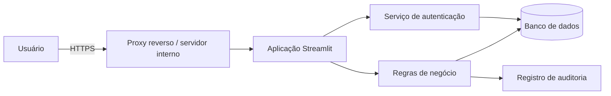

# Plataforma de Remanejamento de Estoque

> Proposta de apresentação para um repositório público no GitHub. Esta pasta é uma demonstração documental: não contém dados, credenciais, infraestrutura ou regras internas da operação.

Aplicação Streamlit para solicitar, acompanhar e auditar transferências de estoque entre filiais. O repositório público mostra a arquitetura, a experiência de uso e os padrões de engenharia. A operação real fica em um repositório privado.

## O problema

Transferências entre lojas costumam depender de planilhas, validações manuais e fontes diferentes de informação. A plataforma reúne esse fluxo em uma única interface, com seleção de SKUs, plano de transferência, registro de solicitações e auditoria.

## O que a aplicação oferece

- Busca e seleção individual ou em lote de SKUs.
- Planos de transferência manual, de concentração e de distribuição.
- Registro direto ou revisão prévia de uma solicitação.
- Histórico e auditoria das movimentações.
- Controle de acesso por usuário, sessão e perfil.
- Experiência guiada para novos usuários.
- Ambiente de demonstração com dados inteiramente fictícios.

## Como o repositório público seria organizado

```text
remanejamento-estoque/
├── app.py                      # ponto de entrada Streamlit
├── src/
│   ├── domain/                 # regras de negócio independentes da interface
│   ├── services/               # casos de uso: solicitação, auditoria e autenticação
│   ├── repositories/           # acesso a dados por interfaces bem definidas
│   ├── infrastructure/         # SQL Server, configuração e observabilidade
│   └── ui/                     # páginas, componentes e tema Streamlit
├── tests/                      # testes unitários e de integração
├── migrations/                 # mudanças versionadas no banco
├── demo_data/                  # dados sintéticos para portfólio
├── docs/                       # decisões técnicas e documentação de segurança
├── .github/                    # verificação automática e manutenção de dependências
├── .env.example                # somente nomes de variáveis, sem segredos
├── SECURITY.md                 # política de comunicação de vulnerabilidades
└── README.md
```

Veja a visão completa em [Estrutura do repositório](docs/ESTRUTURA.md).

## Arquitetura proposta



A separação entre interface, regras de negócio e dados torna as mudanças mais fáceis de testar. Também evita que regras de segurança fiquem espalhadas pelas telas. Há mais detalhes em [Arquitetura](docs/ARQUITETURA.md).

## Segurança por padrão

O repositório público não inclui dados reais, arquivos operacionais, nomes de servidores, caminhos internos ou segredos. Na versão planejada, a aplicação usa:

- Senhas armazenadas somente como hashes fortes com salt.
- Sessões invalidadas por inatividade e por alteração de senha.
- Autorização no servidor para cada operação sensível.
- Conta SQL exclusiva, com o menor conjunto possível de permissões.
- Conexão criptografada e validação do certificado do banco.
- Registro de auditoria sem expor dados sensíveis.
- Exportações protegidas contra fórmulas injetadas em planilhas.
- Verificação contínua de testes, dependências e segredos antes de cada publicação.

A proposta completa está em [Segurança](docs/SEGURANCA.md).

## Demonstração pública x operação privada

| Tema | Demonstração pública | Operação privada |
| --- | --- | --- |
| Dados | Sintéticos e anonimizados | Dados corporativos |
| Banco | SQLite local ou base demo isolada | SQL Server interno com TLS |
| Acesso | Sem integração corporativa | Usuários e permissões reais |
| Relatórios | Dados de exemplo | Fluxos e documentos operacionais |
| Configuração | `.env.example` | Segredos fora do Git |

Essa separação permite apresentar o projeto sem expor a infraestrutura corporativa.

## Qualidade e manutenção

Antes de uma mudança chegar ao ambiente oficial, o GitHub verifica formatação, testes, análise estática, vulnerabilidades conhecidas nas dependências e possível exposição de segredos. Atualizações de dependências são abertas para revisão antes da aprovação.

Consulte [Publicação e automação](docs/PUBLICACAO.md) e [Como contribuir](CONTRIBUTING.md).

## Estado desta demonstração

Esta pasta mostra como o repositório pode ficar. O código do ambiente de desenvolvimento só será levado para cá depois das correções de segurança, da remoção de referências internas e da substituição de dados reais por dados sintéticos.

