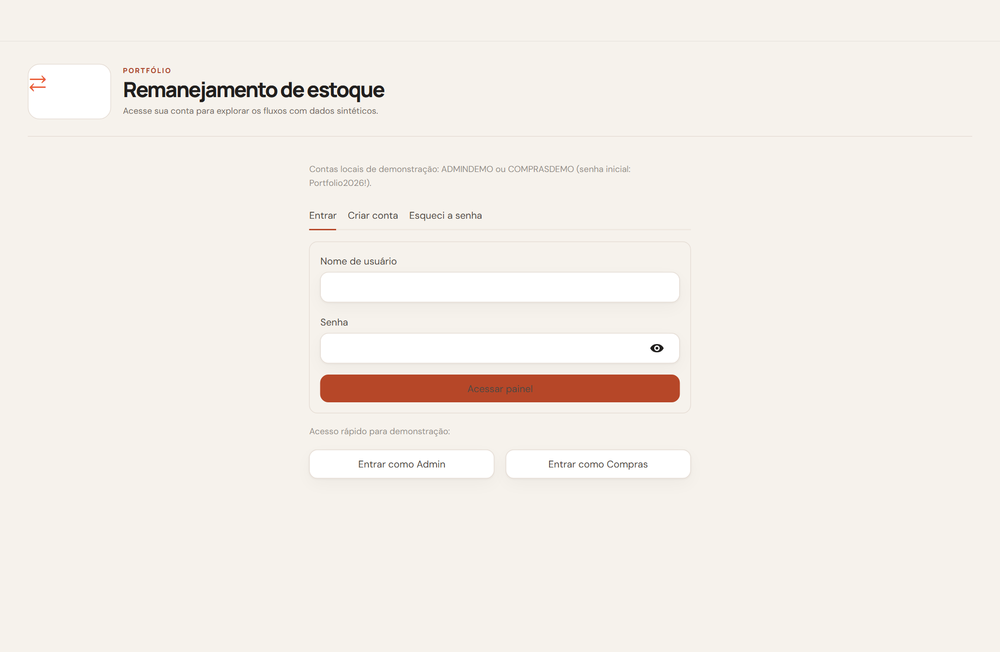
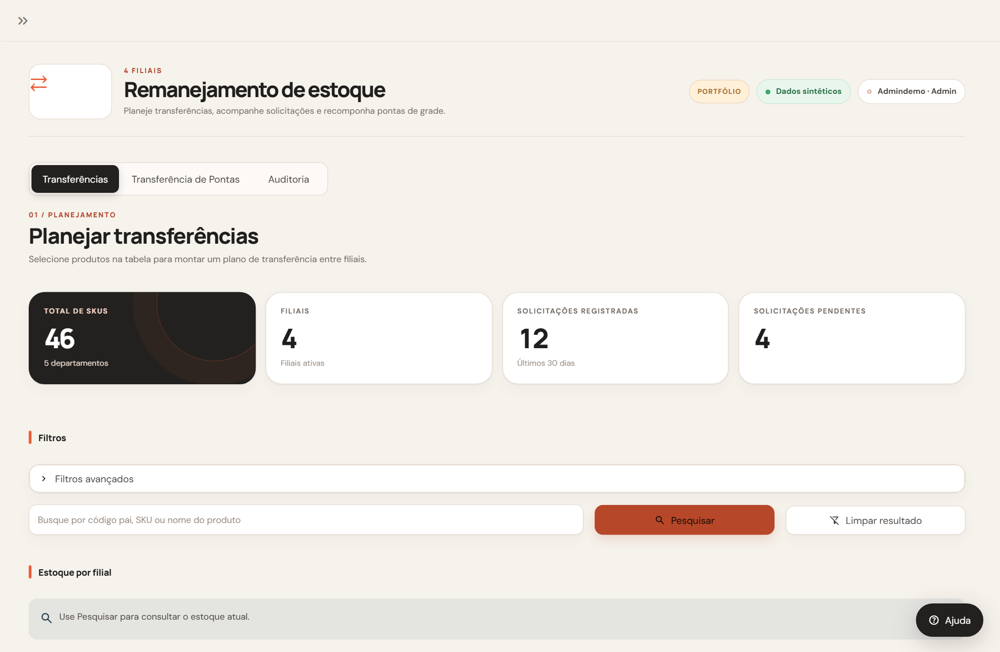
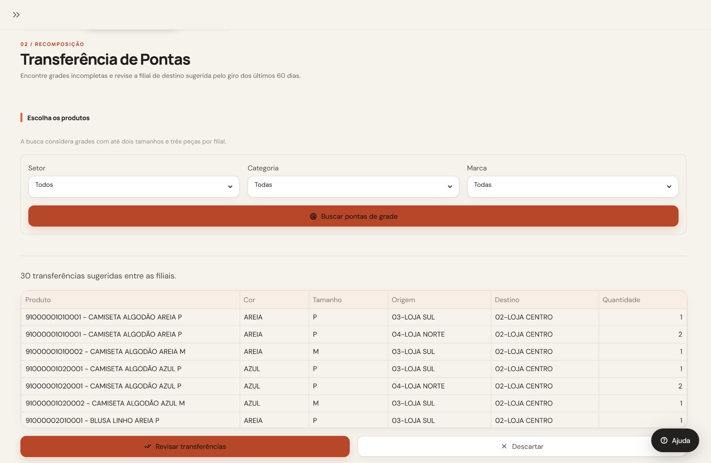
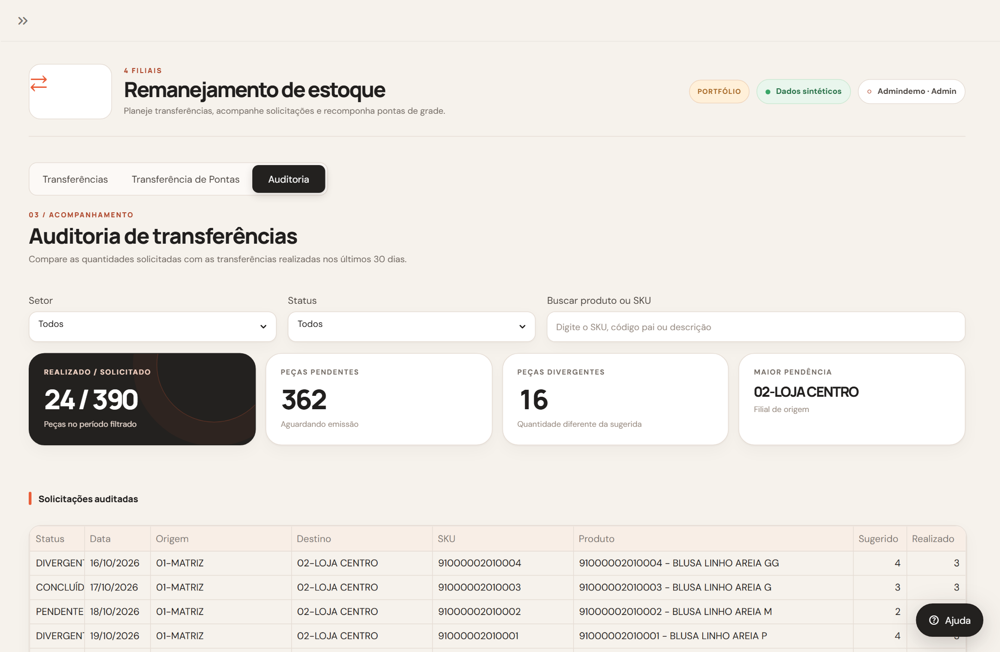

# Remanejamento de estoque entre filiais

Aplicação em Python e Streamlit para planejar transferências de mercadorias, recompor grades quebradas e auditar a execução entre lojas. Esta versão utiliza SQLite e uma massa de dados sintética para execução local sem dependência de infraestrutura externa.

## Problema operacional

Redes de varejo físico acumulam dois desequilíbrios frequentes no estoque das lojas:
1. Ruptura de produtos de giro rápido em algumas filiais enquanto outras acumulam excesso do mesmo SKU.
2. Grades de vestuário e calçados furadas (com um ou dois tamanhos restantes e poucas peças), que perdem conversão na área de vendas.

Quando o remanejamento depende de planilhas avulsas, o comprador gasta horas cruzando saldos, erra quantidades disponíveis e perde o rastreamento do que foi solicitado contra o que de fato saiu das lojas. Este painel centraliza a consulta de estoque, o cálculo das sugestões, o registro das solicitações e a auditoria pós-emissão.

## Telas da aplicação

O fluxo de trabalho está organizado em uma tela de autenticação e três módulos operacionais:

### Acesso e autenticação
Controle de sessão com perfis distintos (`Admin` e `Compras`), recuperação de senha e botões de acesso rápido com 1 clique para explorar o ambiente de demonstração sem digitar credenciais.



### 01. Planejamento de transferências
Visão consolidada do catálogo com indicadores da rede, filtros por departamento/marca e consulta de saldo por filial para simular transferências manuais, por concentração ou por distribuição cadenciada.



### 02. Transferência de pontas de grade
Varredura automática de modelos que ficaram com grade incompleta nas lojas (até dois tamanhos e três peças disponíveis), sugerindo a filial de destino com base no maior giro dos últimos 60 dias.



### 03. Auditoria de execução
Acompanhamento das solicitações registradas nos últimos 30 dias em comparação com as transferências efetivamente emitidas, destacando volumes pendentes, divergências de quantidade e a filial com maior acúmulo de pendências.



## Motor analítico e regras de decisão

O módulo `calculos.py` implementa três estratégias de movimentação e uma rotina de conciliação:

### 1. Distribuição cadenciada por cobertura (`calcular_distribuicao_cadenciada`)

Equilibra o estoque entre as filiais participantes a partir do histórico de vendas dos últimos 60 dias:
- Calcula a venda diária de cada SKU por filial: $\text{Venda Diária} = \frac{\text{Vendas}_{60\text{d}}}{60}$.
- Projeta os dias de cobertura do saldo atual: $\text{Dias de Cobertura} = \frac{\text{Estoque Atual}}{\text{Venda Diária}}$.
- Filtra como recebedoras as lojas cuja cobertura caiu abaixo do gatilho de alerta (`dias_alerta`, padrão de 10 dias) e dimensiona a necessidade para atingir a meta de abastecimento (`dias_alvo`, padrão de 25 dias).
- Filtra como doadoras as lojas com saldo acima da trava de exposição na prateleira (`estoque_min_visual`, padrão de 4 peças) e transfere apenas quando o excedente atinge o lote mínimo de transporte (`lote_minimo`, padrão de 2 peças), priorizando as maiores necessidades e os maiores saldos.

### 2. Recomposição de pontas de grade (`calcular_concentracao_pontas`)

Identifica produtos de grade (mesmo modelo pai e cor com múltiplos tamanhos) que ficaram fragmentados na rede:
- Marca como doadoras as filiais que possuem no máximo 2 tamanhos distintos em estoque e volume total igual ou inferior a 3 peças daquela grade.
- Seleciona como filial de destino a loja de maior giro nos últimos 60 dias que, após receber as peças, passe a ter ao menos 2 tamanhos disponíveis. Em caso de empate no volume de vendas, utiliza uma ordem de prioridade entre as filiais.

### 3. Concentração de estoque (`gerar_transferencia_concentracao`)

Recolhe o saldo disponível de uma filial específica ou de toda a rede para uma loja destino escolhida pelo comprador, útil em ações promocionais, liquidações ou fechamento de coleção.

### 4. Auditoria de execução (`auditar_sugestoes`)

Cruza as solicitações gravadas (`solicitacoes`) com as transferências emitidas (`realizadas`) usando a chave composta `(SKU, Filial_origem_ID, Filial_destino_ID)`. Considera válidas as emissões ocorridas a partir de duas horas antes do registro da sugestão e classifica cada item em:
- `CONCLUÍDA`: emissão encontrada com quantidade realizada igual à sugerida.
- `DIVERGENTE`: emissão encontrada com quantidade diferente da solicitada.
- `PENDENTE`: sem emissão registrada dentro do prazo operacional de 10 dias.
- `IGNORADO`: solicitação sem emissão após mais de 10 dias corridos.

## Estrutura do projeto

```text
.
├── app.py                      # Interface Streamlit (planejamento, pontas, auditoria e barra lateral)
├── calculos.py                 # Algoritmos de distribuição, concentração, pontas de grade e auditoria
├── real_data.py                # Consultas locais, validação de gravação e geração de relatório Excel
├── dados_demo.py               # Geração determinística de produtos, saldos, vendas de 60d e histórico
├── banco_local.py              # Conexão e criação de tabelas no SQLite (dados/portfolio.sqlite3)
├── auth.py                     # Cadastro, hash PBKDF2-HMAC-SHA256, bloqueio por falhas e sessões
├── session_bridge.py           # Serviço HTTP local para cookie HttpOnly e controle de inatividade
├── guia.py                     # Etapas do guia interativo por perfil de acesso
├── antigravity.css             # Folha de estilos da interface
├── iniciar_portfolio.cmd       # Atalho de inicialização para Windows
├── requirements.txt            # Dependências fixadas
├── midia_demonstracao/         # Capturas de tela das abas principais utilizadas no README
├── tests/
│   └── test_fluxos.py          # Testes automatizados de autenticação, cálculos, Excel e interface
└── docs/
    ├── ARQUITETURA.md          # Fluxo de execução e separação de camadas
    ├── ESTRUTURA.md            # Responsabilidades de cada módulo
    ├── PUBLICACAO.md           # Cuidados para publicação e demonstração
    └── SEGURANCA.md            # Controles de autenticação, sessão e exportação
```

## Como executar localmente

É necessário ter o Python 3.11 ou superior instalado.

### Windows (PowerShell ou Prompt de Comando)

```powershell
python -m venv .venv
.\.venv\Scripts\python.exe -m pip install -r requirements.txt
.\iniciar_portfolio.cmd
```

### Linux ou macOS

```bash
python3 -m venv .venv
source .venv/bin/activate
pip install -r requirements.txt
streamlit run app.py --server.port 8504 --server.address 127.0.0.1
```

Acesse `http://127.0.0.1:8504` no navegador. Na primeira execução, o aplicativo cria o banco `dados/portfolio.sqlite3` com as contas de demonstração e as solicitações iniciais.

## Contas de demonstração

Na tela de login, você pode usar os botões de acesso rápido de 1 clique ou informar as credenciais abaixo:

| Usuário | Senha inicial | Perfil | Recursos disponíveis |
| --- | --- | --- | --- |
| `ADMINDEMO` | `Portfolio2026!` | Administrador | Planejamento, pontas, auditoria, recuperação de senhas e exportação Excel |
| `COMPRASDEMO` | `Portfolio2026!` | Compras | Planejamento, pontas, auditoria e gestão da própria senha |

## Roteiro rápido para avaliação

1. Acesse com o botão `Entrar como Admin` na tela inicial e avance ou feche o guia de boas-vindas.
2. Na aba `Transferências`, clique em `Pesquisar` (ou digite `91000001`) e marque os SKUs desejados.
3. Alterne entre as estratégias `Concentrar`, `Manual` e `Distribuir` (para testar `Distribuir`, selecione o setor `08-PERFUMARIA` nos filtros avançados e pesquise novamente).
4. Clique em `Revisar transferências` ou `Solicitar diretamente` para gravar o pedido no SQLite.
5. Abra a aba `Transferência de Pontas` e clique em `Buscar pontas de grade` para listar os itens com grade quebrada e a loja destino calculada pelo giro.
6. Abra a aba `Auditoria` para inspecionar os indicadores de peças realizadas versus solicitadas, filtrar por status (`PENDENTE`, `CONCLUÍDA`, `DIVERGENTE`) e identificar a filial com maior volume pendente.
7. Na barra lateral esquerda, expanda `Baixar relatorio`, escolha o intervalo de datas e exporte a planilha `.xlsx` separada por filial de origem.

## Executar os testes automatizados

```powershell
.\.venv\Scripts\python.exe -m unittest discover -s tests -v
```

A suíte valida o cadastro e o bloqueio de login após 5 tentativas, a revogação de sessão na troca de senha, a expiração por ociosidade de 5 minutos, os cálculos de distribuição e pontas, o bloqueio de duplicatas na gravação, a proteção contra injeção de fórmulas no Excel e o fluxo completo de interface via `Streamlit AppTest`.
