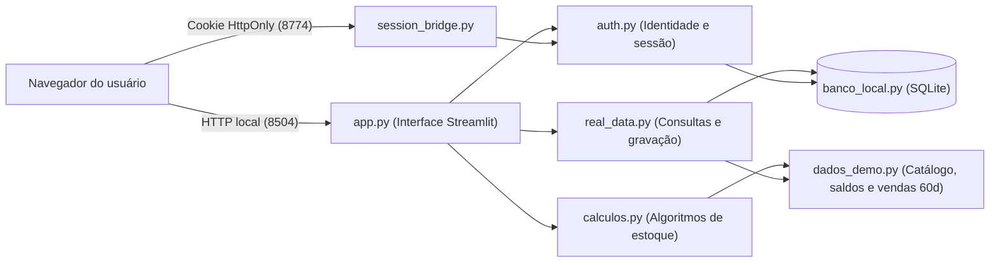
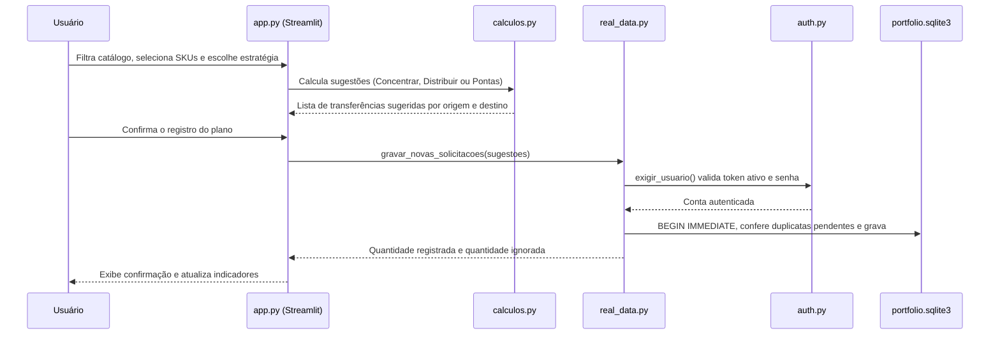

# Arquitetura da aplicação

## Fluxo de execução e camadas

A aplicação separa a interface Streamlit das regras de cálculo, persistência e autenticação:

## Ciclo de uma solicitação de transferência

## Decisões técnicas

### Persistência híbrida na demonstração

O catálogo de produtos, os saldos de estoque e as vendas dos últimos 60 dias vêm de funções determinísticas em `dados_demo.py`. Assim, os cenários de excesso, ruptura e grade furada estão sempre prontos para teste. Já as contas de usuário, as sessões, os pedidos de recuperação de senha e as novas solicitações de transferência são gravados em `dados/portfolio.sqlite3` por `banco_local.py`.

### Validação de sessão no servidor em cada operação

O Streamlit pode reexecutar apenas um diálogo (`@st.dialog`) ou um fragmento (`@st.fragment`) sem rodar o topo do script principal. Por isso, `real_data.py` e `auth.py` chamam `exigir_usuario()` dentro de cada função que lê dados restritos, grava solicitações, emite senhas temporárias ou exporta o relatório Excel.

### Continuidade da sessão após recarregar a página

O módulo `session_bridge.py` inicia um servidor HTTP local na porta `8774` para gravar um cookie `HttpOnly` com `SameSite=Strict`. Quando o usuário recarrega a página com `F5`, `app.py` lê o cookie via `st.context.cookies` e restaura a sessão caso não tenha passado mais de 5 minutos sem interação. Se o aplicativo rodar em um ambiente de nuvem onde a porta secundária não esteja acessível ao navegador, a sessão continua funcionando normalmente em memória pelo `st.session_state`.
