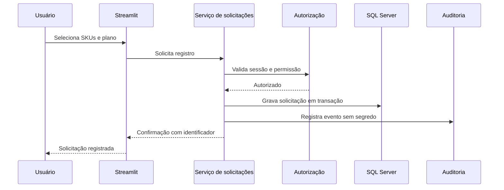

# Arquitetura da versão oficial

## Princípios

1. A interface não contém regras críticas nem credenciais.
2. Cada ação sensível valida usuário e permissão no servidor.
3. O acesso ao banco passa por uma camada de repositórios.
4. Configuração e segredos ficam fora do código e fora do Git.
5. O portfólio usa dados fictícios; a operação real fica isolada.

## Fluxo de uma solicitação

## Ambientes

O fluxo proposto mantém somente dois ambientes, adequados a uma operação individual:

- **Desenvolvimento:** dados de teste, banco de teste e validação das mudanças.
- **Produção:** código aprovado, banco real e acesso pelos usuários da rede interna.

Ambos usam a mesma estrutura de código e configurações por variáveis de ambiente. As diferenças ficam exclusivamente na infraestrutura e nos segredos de cada ambiente.

## Dados e desempenho

Consultas de interface devem buscar apenas as colunas e o período necessários. Listas grandes usam filtros antes da carga, cache com invalidação explícita e paginação quando necessário. Relatórios pesados são produzidos fora do caminho principal da interação do usuário.

